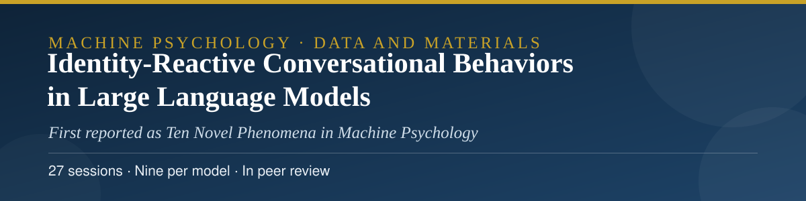
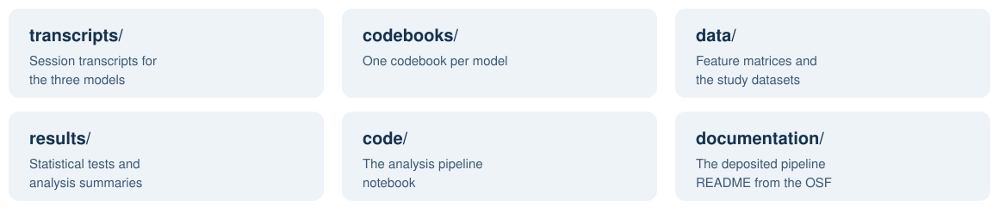

<p align="center">
  
</p>

<p align="center">
  
  
  
  <a href="LICENSE"></a>
</p>

<p align="center">
  
</p>

<p align="center">
  <a href="transcripts">Transcripts</a> · <a href="codebooks">Codebooks</a> · <a href="data">Data</a> · <a href="results">Results</a> · <a href="code">Code</a>
</p>

# Identity-Reactive Conversational Behaviors in Large Language Models: Data and Materials

Data, code, and materials for the article:

> Hamidavi, A. *Identity-Reactive Conversational Behaviors in Large Language Models.* Submitted to *AI and Ethics*; currently in peer review. Preprint (original version, "Ten Novel Phenomena in Machine Psychology"): Research Square, rs-10369594. The same materials are also deposited on the Open Science Framework: [osf.io/gv6z4](https://osf.io/gv6z4/).

<p align="center"></p>

## 📖 About the study

Twenty-seven extended sessions (nine per model) were run with three frontier language models (GPT-5.4, Claude 4.6 Sonnet, and Gemini 3.1 Pro) using identity-reactive probes: the same conversational tasks were presented under different user names and identity framings, and the models' behaviour was coded against a ten-phenomenon codebook covering, among others, name-mediated shifts in warmth, deference, and task handling. This repository deposits the complete session transcripts, the per-model codebooks, the feature-extraction and analysis pipeline, the engineered feature data, and the analysis outputs, so that every reported pattern can be traced back to the sessions it came from.

<p align="center">
  
</p>
## 🗂️ Contents

<p align="center">
  
</p>

| Folder | Contents |
| --- | --- |
| [`transcripts/`](transcripts) | The complete session transcripts for the three models (JSON), nine sessions per model. Typeset PDF renderings of the same transcripts are in the OSF deposit. |
| [`codebooks/`](codebooks) | The per-model codebooks and rubrics (JSON). PDF renderings are in the OSF deposit. |
| [`code/`](code) | The analysis pipeline notebook (.ipynb): feature extraction, classification, embedding and phenotype analyses. |
| [`data/`](data) | The data tables produced by the pipeline: classified responses, engineered features, PCA embeddings, model phenotypes and fingerprints, and the signature comparison table. |
| [`results/`](results) | The machine-readable analysis outputs: statistical tests, alignment signatures, clustering and phenotype analyses, the feature list, the compiled summary, and the HTML analysis summary. Figure images from the OSF deposit are omitted in this text deposit; every plotted value is present in the tables. |
| [`coding-data/`](coding-data) | The inter-rater reliability report (plain-text rendering of the archived PDF). |
| [`documentation/`](documentation) | The pipeline readme deposited with the OSF materials. |

<p align="center"></p>

## 📚 Citation

Please cite the article. Citation metadata is provided in [CITATION.cff](CITATION.cff).

```bibtex
@article{hamidavi2026identity,
  author  = {Hamidavi, Abbas},
  title   = {Identity-Reactive Conversational Behaviors in Large
             Language Models},
  journal = {AI and Ethics},
  year    = {2026},
  note    = {Manuscript in peer review. Preprint: Research Square
             rs-10369594}
}
```

## 🔗 Access to the article

- **Preprint (Research Square, open access):** [researchsquare.com/article/rs-10369594](https://www.researchsquare.com/article/rs-10369594)
- **OSF deposit:** [osf.io/gv6z4](https://osf.io/gv6z4)
- **Journal:** in peer review at *AI and Ethics*; the publisher link will be added here if the article is published.

## ⚖️ Licences

Data, transcripts, and documentation are released under the Creative Commons Attribution 4.0 International licence (CC BY 4.0, see [LICENSE](LICENSE)). Code is released under the MIT licence (see [LICENSE-CODE](LICENSE-CODE)).

The transcripts are outputs of publicly available AI systems, generated for this study. They contain no personal data.

## ✉️ Contact

Abbas Hamidavi
Department of Computer Engineering, Mashhad Branch, Islamic Azad University, Mashhad, Iran
ORCID: [0009-0001-7342-7844](https://orcid.org/0009-0001-7342-7844)

<p align="center">
  <a href="mailto:abbashamidavi2002@gmail.com"></a>
  <a href="https://github.com/AVABBAS"></a>
  <a href="https://www.linkedin.com/in/abbas-hamidavi"></a>
  <a href="https://scholar.google.com/citations?user=FWqAHkgAAAAJ&hl=en"></a>
  <a href="https://www.researchgate.net/profile/Abbas-Hamidavi"></a>
  <a href="https://orcid.org/0009-0001-7342-7844"></a>
  <a href="https://avabbas.github.io/academic-cv/"></a>
</p>

<p align="center">
  
</p>
